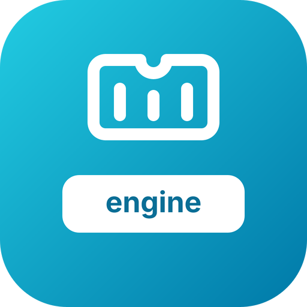
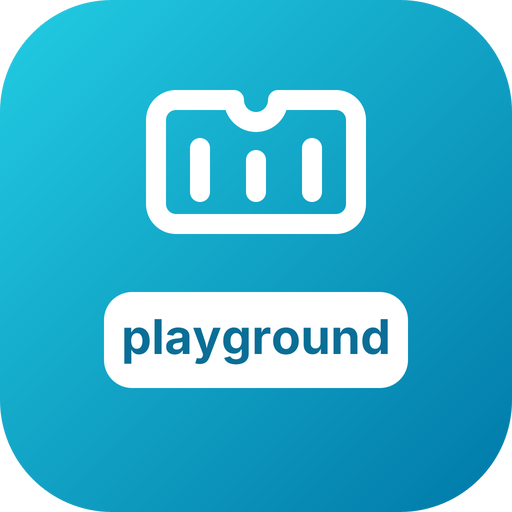

# go-wasmcontainers — brand assets

Official logos for the **go-wasmcontainers** organization.

   

## The mark

A shipping container: a ribbed box whose top edge carries the notch of the
WebAssembly logo. That is what the organisation makes — a container that is a
WASI module.

⛔ **The colours are not chosen here.** go-wasmcontainers joins the **systems
family** — `go-filesystems`, `go-volumes`, `go-virtio`, `go-diskimages`,
`go-bootloaders` — and takes its gradient, `#22CCE2 → #0079A8`, with the grammar
every mark in that family shares: a 256 px plate at `rx="56"`, and a white line
glyph with round caps and joins (`stroke-width="13"`, the width most of the
family uses).

`go-wasmcontainers-engine`, `go-wasmcontainers-playground` and
`go-wasmcontainers-dashboard` are the marks of the `engine`, `playground` and
`dashboard` repositories: the same glyph, smaller and higher,
over a white name plate — the family's per-repository convention, not a glyph
of their own.

## Formats

For each of `go-wasmcontainers`, `go-wasmcontainers-engine`,
`go-wasmcontainers-playground` and `go-wasmcontainers-dashboard`:

- **SVG** — `svg/color`, `svg/white` (white, transparent), `svg/black` (black, transparent)
- **PNG** 16→1024 px, 3 variants — `png/<variant>/<size>/`
- **JPG** (color, white background) — `jpg/<size>/`
- **ICO** (Windows) — `ico/`
- **ICNS** (macOS) — `icns/`
- **GitHub avatar** 512 px — `avatar/`
- **Social preview** 1280×640 (repo banner) — `social/`

`check/kit.py` counts the whole matrix, for all four subjects, on every pull
request.

---
*`svg/color/*.svg` are the sources; every other file is generated from them by
the fleet's Go brand pipeline (brandgen, with go-gfx and go-opentype) — rounded
square badge, line glyph, color / white / black variants.*
